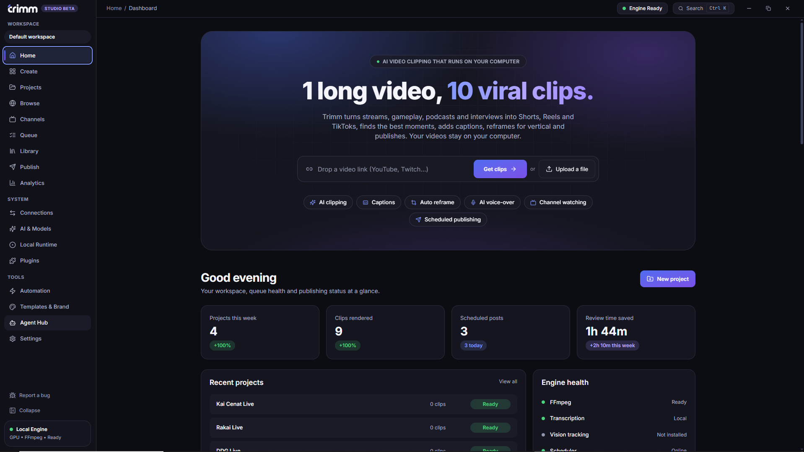
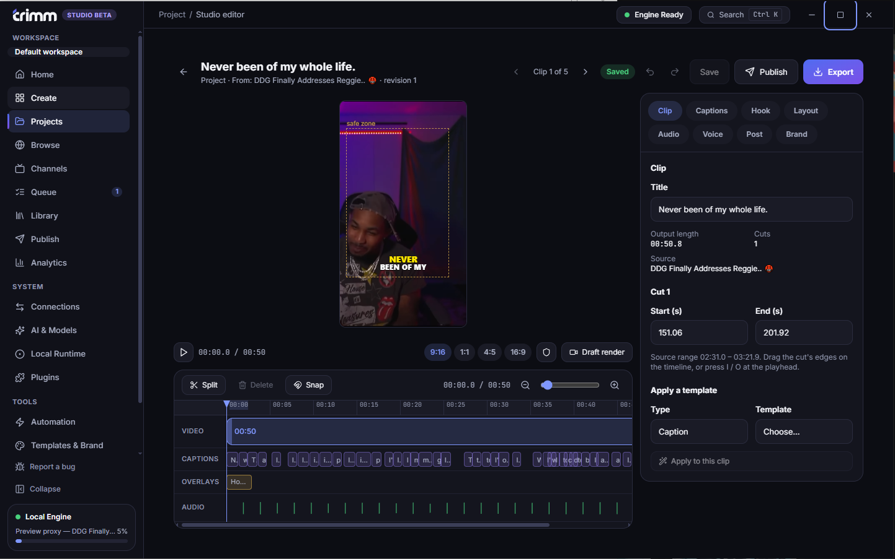
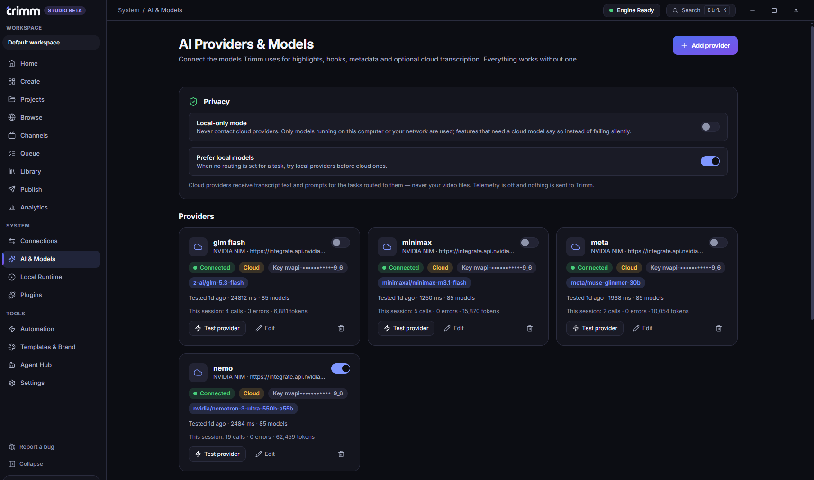

# Trimm Studio

**Turn long videos, streams and gameplay into clips ready to post. Free, and it runs on your computer.**

> **Public beta.** Trimm Studio is new and still has rough edges. It is free to use and updated often. If something
> breaks, please [report a bug](../../issues/new/choose). In the app, **Report a bug** (bottom of the left menu)
> fills in the report for you. Nothing is sent until you press Submit on GitHub.

Trimm finds the best moments, adds captions, reframes for vertical, writes an optional AI voice-over for your game
clips, and gets everything ready to publish. Your footage is never uploaded anywhere unless you choose a cloud AI.

**[Download the latest version](../../releases)**

## Screenshots







## Install (Windows 10 or 11, 64-bit)

1. Download **`Trimm Studio_…_x64-setup.exe`** from the [latest release](../../releases), or the portable
   **`Trimm-Studio-portable-x64.zip`** (unzip it anywhere and run `Trimm Studio.exe`; everything stays in one folder).
2. Install **FFmpeg**, which Trimm uses to read and render video. Open PowerShell and run:

   ```powershell
   winget install Gyan.FFmpeg
   ```

3. Open Trimm Studio. A first-run check shows what is installed and what is missing, with a fix for each.

**Windows may warn you** ("Windows protected your PC") because the installer isn't code-signed yet. Choose **More
info**, then **Run anyway**. To confirm your download is genuine, compare its SHA-256 with `SHA256SUMS.txt` on the
release page:

```powershell
Get-FileHash .\Trimm-Studio-portable-x64.zip -Algorithm SHA256
```

## What it does

* **Finds the best moments.** From a transcript (hooks, questions, emotion), from the sound and picture, or both. For
  gameplay with no talking it looks for loud, fast and sudden moments.
* **Captions and an editor.** Word-by-word caption styles, your own caption files, a timeline to trim, split and reframe.
* **Reframes** for vertical, square or wide, with face tracking and blurred backgrounds.
* **AI voice-over for game clips.** The AI looks at the clip, writes narration for your game, and a local or cloud voice
  reads it over the game audio.
* **Watches YouTube channels** for new uploads and clips them.
* **Drafts and schedules posts** for YouTube Shorts, TikTok and Instagram Reels. Nothing posts until you approve it.
* **Works with agents** such as Claude and Codex over MCP.

## Free, and you bring your own AI key

Trimm costs nothing and has no accounts or clip limits. The AI features use **your own account** with a provider such
as Anthropic (Claude), OpenAI, Google Gemini, Groq, NVIDIA or Mistral, or a model on your own computer (Ollama, LM
Studio). You pay your provider directly. Your keys stay in the Windows credential store.

Works with no AI key at all: clipping from sound and picture, captions you write or import, the editor, offline
transcription and local voices.

## Privacy

No tracking, no analytics, no account. Videos are processed on your computer, and data leaves only when you pick a
service that needs it. Details: **[PRIVACY.md](PRIVACY.md)**.

## Terms

Free to use, including for business, and **not open source**. Plain-language summary: **[TERMS.md](TERMS.md)**.
Full agreement: [LICENSE](LICENSE). Open-source components Trimm includes, with their licenses:
[THIRD_PARTY_NOTICES.md](THIRD_PARTY_NOTICES.md) and [THIRD_PARTY_LICENSES.md](THIRD_PARTY_LICENSES.md).

Only process videos you own or have permission to use, and follow the rules of the sites you download from and post
to.

## Known issues in this beta

* **Windows warning.** The installer is not code-signed yet, so Windows shows "protected your PC". See Install above.
* **FFmpeg is separate.** Install it with the command above, or point Local Runtime at your own copy.
* **Windows only.** A Linux build exists but has not been tested, so it is not offered yet.
* **Highlights without a transcript** look for loud, fast and sudden moments. A loud menu can score well, so review the picks.
* **First offline transcription** downloads a speech model (about 145 MB) once.
* **Browse** opens a separate browser window, not a panel inside the app.

## Help and bug reports

Use **Report a bug** inside the app, or open an [issue](../../issues/new/choose). Please include your Trimm version
(Settings, then Diagnostics) and what you did. Do not post API keys, passwords or private videos.

---

&copy; 2026 24HourLifestyle LLC. This repository holds downloads and documentation. Trimm Studio's source code is not
published.
